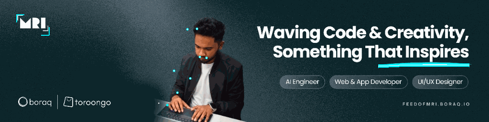
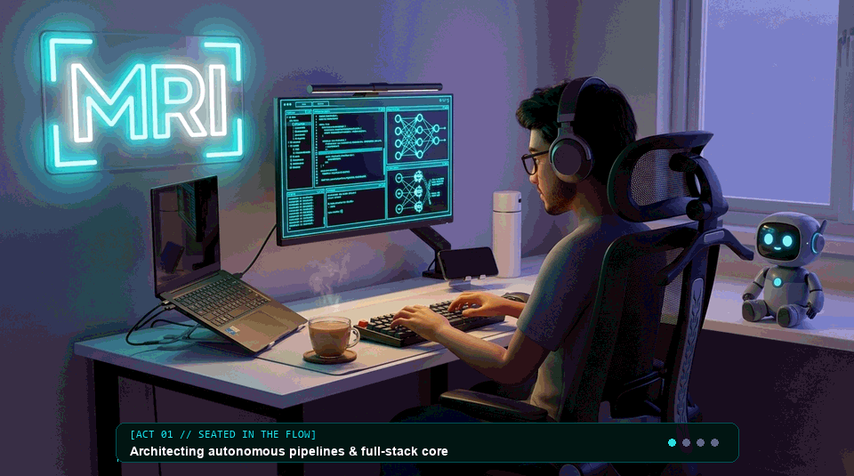
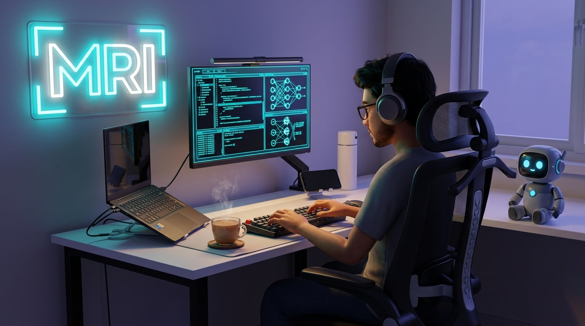
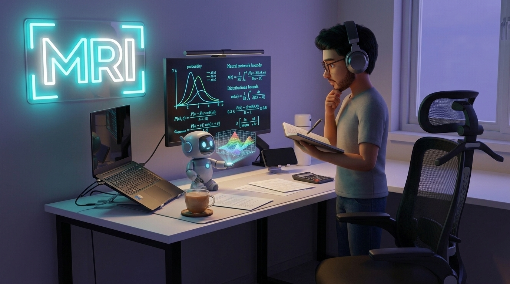
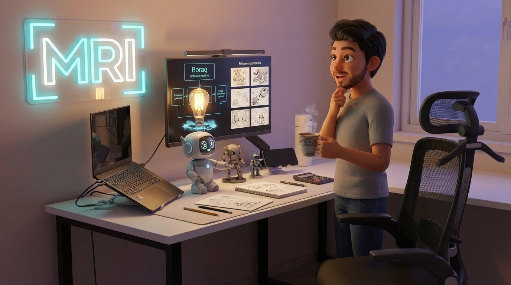
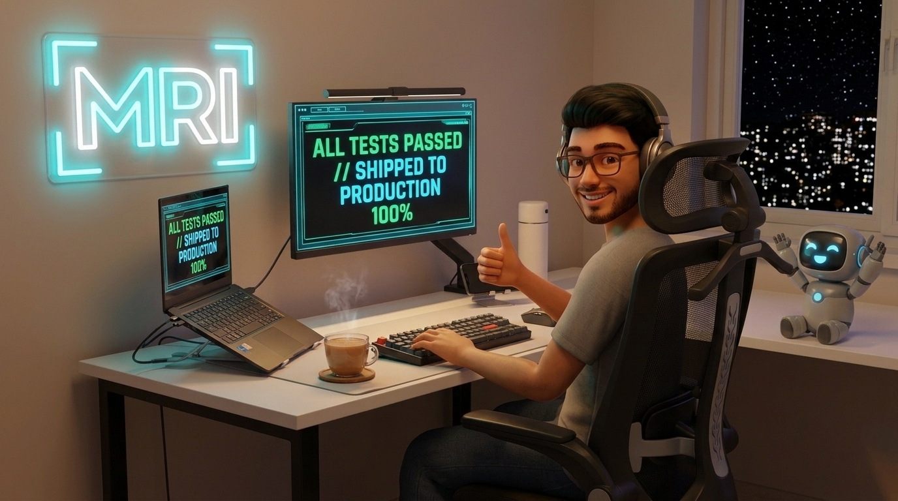
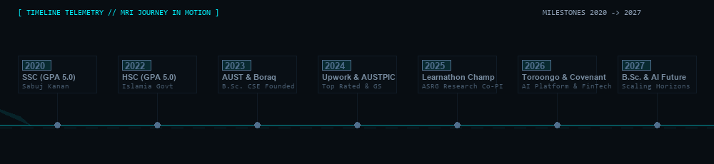
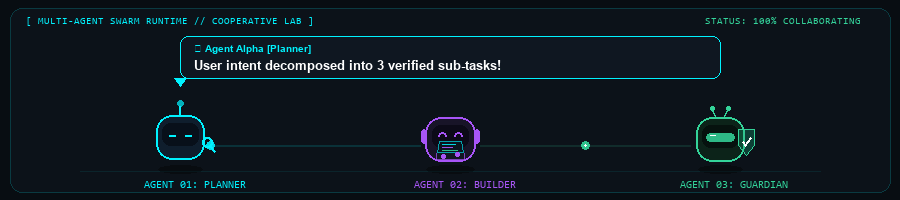
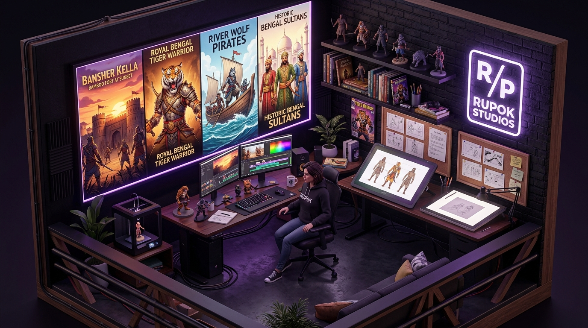

<div align="center">

<!-- OFFICIAL BRANDING ANIMATED MOTION BANNER -->
<a href="https://feedofmri.boraq.io">
  
</a>

<br/>

<!-- DYNAMIC ANIMATED TYPING HEADER -->
<a href="https://feedofmri.boraq.io">
  
</a>

<br/>

<!-- OFFICIAL VENTURE & IDENTITY BADGES -->
<p align="center">
  <a href="https://feedofmri.boraq.io"></a>
  <a href="https://boraq.io"></a>
  <a href="https://toroongo.com"></a>
  <a href="https://rupok.org"></a>
  <a href="assets/Rubayet-Islam-CV.pdf"></a>
</p>

<!-- REALTIME STATUS TELEMETRY -->
<p align="center">
  
  
  
  
</p>

<!-- CALM SMOOTH ANIMATED DIVIDER -->


</div>

### 🧬 Creative Technologist &amp; Architect DNA

```yaml
# ~/feedofmri/creative_dna.yaml
identity: "Md. Rubayet Islam (@feedofmri)"
mantra: "Waving Code & Creativity, Something That Inspires"
mana_source: "Dark Roast Chai + Focused Ambience + Bengal Mythic Epics"
superpowers:
  - "Designing intentional design systems in Figma, then shipping the code"
  - "Architecting autonomous multi-agent pipelines with formal safety bounds"
  - "Directing 4K episodic AI animation pipelines at Rupok Studios"
current_quest: "Proving certified patch acceptance models & deploying satellite mesh nodes"
easter_egg: "Can fix a distributed consensus glitch while rendering anime keyframes"
```

<div align="center">
  
</div>

### 🏢 The Creative Sanctum &amp; Daily Routine `// Real Desk &bull; 1-Minute Creative Story Loop`

<div align="center">
  <a href="https://feedofmri.boraq.io">
    
  </a>
</div>

<br/>

#### ⏳ The 4 Acts of Creation `// From Mathematical Bound to Production Ship`

<table>
  <tr>
    <td width="25%" valign="top">
      <h4 align="center">⚡ Act 01: Seated Flow</h4>
      <p align="center">
        
      </p>
      <p><b>Waking the Stack:</b> Headphones on, dark roast chai steaming, mechanical keyboard clacking. Orchestrating autonomous multi-agent pipelines and reactive frontends for Boraq &amp; Toroongo.</p>
    </td>
    <td width="25%" valign="top">
      <h4 align="center">🔬 Act 02: Standing Research</h4>
      <p align="center">
        
      </p>
      <p><b>Rigorous Science:</b> Standing up from the ergonomic mesh chair, pen in hand. Deriving formal statistical safety bounds and conformal prediction models for Certified Patch Acceptance.</p>
    </td>
    <td width="25%" valign="top">
      <h4 align="center">🎨 Act 03: The Chai Spark</h4>
      <p align="center">
        
      </p>
      <p><b>Creative Synthesis:</b> Pacing with hot chai. The "Aha!" moment connects deep distributed systems with Bengal folklore storyboards (<i>Bansher Kella</i>) at Rupok Studios.</p>
    </td>
    <td width="25%" valign="top">
      <h4 align="center">🚀 Act 04: Midnight Victory</h4>
      <p align="center">
        
      </p>
      <p><b>Shipping to Prod:</b> Back in the zone under the neon <code>[MRI]</code> glow. All unit &amp; regression tests pass 100%. Code deployed to live production. High-five with Agent Alpha!</p>
    </td>
  </tr>
</table>

<div align="center">
  
</div>

### 🚀 Production Ecosystem &amp; Live Ventures

<table>
  <tr>
    <td width="33%" valign="top">
      <h4 align="center">⚡ Boraq Studio</h4>
      <p align="center">
        <a href="https://boraq.io"></a>
      </p>
      <p><b>Lead Software Architect &amp; Founder</b><br/>
      High-craft software studio designing, engineering, and deploying scalable full-stack web, mobile, and autonomous AI systems for international clients and in-house venture ideas.</p>
      <p><code>React</code> &bull; <code>Node.js</code> &bull; <code>Flutter</code> &bull; <code>AI Agents</code></p>
    </td>
    <td width="33%" valign="top">
      <h4 align="center">🛒 Toroongo Platform</h4>
      <p align="center">
        <a href="https://toroongo.com"></a>
      </p>
      <p><b>AI Systems Architect &amp; Founder</b><br/>
      Zero-commission multivendor marketplace connecting local merchants directly with buyers, powered by autonomous customer support agents and smart inventory alerts.</p>
      <p><code>Laravel</code> &bull; <code>FastAPI</code> &bull; <code>Multi-Agent</code> &bull; <code>MySQL</code></p>
    </td>
    <td width="33%" valign="top">
      <h4 align="center">🎬 Rupok Studios</h4>
      <p align="center">
        <a href="https://rupok.org"></a>
      </p>
      <p><b>Creative Tech &amp; Direction</b><br/>
      Animation and comics studio bringing Bengal’s epic history and mythic folklore to life across 7 original episodic series, headlined by <i>Bansher Kella</i>.</p>
      <p><code>AI Animation</code> &bull; <code>Three.js</code> &bull; <code>Story Pipelines</code></p>
    </td>
  </tr>
  <tr>
    <td width="50%" valign="top" colspan="2">
      <h4>🛡️ Covenant — Guarded AI Agent Smart Wallet</h4>
      <p><b>International Finalist &bull; PBCSF Fintechathon 2026 (Topic F: Agent Wallet)</b><br/>
      Autonomous agent smart wallet architecture with cryptographic policy enforcement, risk-tiered agent authorization, and multi-agent consensus verification.</p>
      <p><code>Autonomous Agents</code> &bull; <code>Fintech</code> &bull; <code>Smart Contracts</code> &bull; <code>Formal Safety</code></p>
    </td>
    <td width="50%" valign="top">
      <h4>🛰️ Project L.A.S.T. — Disaster Satellite Mesh</h4>
      <p><b>Co-Principal Investigator &bull; AUST Student Research Grant (ASRG)</b><br/>
      Low-power delay-tolerant IoT mesh network integrating LoRa nodes and low-earth orbit satellite links for life-saving connectivity during cyclone blackouts.</p>
      <p><code>LoRa Mesh</code> &bull; <code>Satellite IoT</code> &bull; <code>C++</code> &bull; <code>Distributed Systems</code></p>
    </td>
  </tr>
</table>

<div align="center">
  
</div>

### 🚴 The Milestone Journey in Motion `// 2020 ➔ 2027`

<div align="center">
  
</div>

<div align="center">
  
</div>

### 🧠 Master Skill Matrix &amp; Technologies

<div align="center">

#### AI Systems, Multi-Agent Orchestration &amp; RAG

<div align="center">
  
</div>

<p align="center">
  
</p>
<p align="center">
  
  
  
  
  
</p>

#### Full-Stack Platforms &amp; Mobile Ecosystem
<p align="center">
  
</p>

#### Core Languages &amp; Systems Engineering
<p align="center">
  
</p>

#### Databases, DevOps &amp; Cloud Infrastructure
<p align="center">
  
</p>

#### Creative Tech, Motion &amp; UI/UX Craft

<div align="center">
  <a href="https://rupok.org">
    
  </a>
</div>

<p align="center">
  
</p>

</div>

<div align="center">
  
</div>

### 📊 Real-Time GitHub Analytics &amp; Activity

<div align="center">

<table align="center" border="0" cellpadding="0" cellspacing="0">
  <tr>
    <td align="center" valign="middle">
      <a href="https://github.com/feedofmri">
        
      </a>
    </td>
    <td align="center" valign="middle">
      <a href="https://github.com/feedofmri">
        
      </a>
    </td>
  </tr>
  <tr>
    <td colspan="2" align="center" valign="middle">
      <br/>
      <a href="https://github.com/feedofmri">
        
      </a>
    </td>
  </tr>
</table>

</div>

<div align="center">
  
</div>

### 🏆 Honors &amp; Milestones

| Year | Recognition | Scope / Organization | Category |
|:---:|:---|:---|:---|
| **2026** | 🛡️ **Fintechathon Finalist (Topic F: Agent Wallet)** | PBCSF Fintechathon 2026 | *Autonomous AI Wallets* |
| **2025** | 🏆 **Learnathon 3.0 Champion (Grand Prize BDT 50k)** | Brain Station 23 PLC | *Flutter Cross-Platform* |
| **2025** | 🔬 **AUST Student Research Grant (Co-PI)** | Ahsanullah University &bull; Project L.A.S.T. | *Satellite Mesh &amp; IoT* |
| **2025** | 🌐 **Web Architect Recognition Crest** | National IUPC 2025 (100+ Volunteers) | *Contest Architecture* |
| **2024** | 🥇 **Champion — Carnival 5.0** | AUST CSE Carnival | *UI/UX Interface Design* |
| **2024** | 🏅 **General Secretary** | AUSTPIC (Programming &amp; Informatics Club) | *Executive Leadership* |
| **2023** | 🥇 **Champion — Carnival 4.0** | AUST CSE Carnival | *UI/UX Interface Design* |
| **2024–26**| ⭐ **Top Rated 5.0 / 5.0** | Upwork Worldwide Freelance | *Web &amp; Mobile Architecture* |

---

<details>
<summary><b>🕹️ Press to Unlock Secret Developer Quests &amp; Easter Eggs!</b></summary>
<br/>

* 🎯 **Quest 01 &mdash; The Bug Hunter**: Find a statistical flaw in our certified patch acceptance theorem. *Reward: Unlimited chai on me.*
* 🐅 **Quest 02 &mdash; The Bengal Lorekeeper**: Can you name the primary river channel where Isa Khan defeated the Mughal imperial fleet? *(Hint: It's in Season 1 of The River Wolves).*
* ⚡ **Fun Fact**: I design the Figma tokens, write the Solidity/Python backend, configure the Docker deployment, and animate the launch trailer myself. Nothing gets lost in translation.
* 🍵 **Daily Fuel**: Earl Grey tea, deep focus playlists, and an unhealthy curiosity for distributed consensus edge cases.

</details>

<details>
<summary><b>⚡ Architectural Philosophy &amp; Core Principles</b></summary>
<br/>

1. **Own the whole loop**: When you understand the design, the database schema, and the deployment script, nothing gets lost in translation between teams.
2. **Design is how it works**: Interfaces must be intentional. Layouts don’t break on edge cases, animations communicate state, and performance is built into the foundation.
3. **Build for real human hands**: Theoretical polish matters, but putting working software in front of actual users early and iterating aggressively wins every time.

</details>

<div align="center">
  
</div>

### 🌐 Connect &amp; Let's Build Something Extraordinary

<div align="center">

<p>
  <a href="https://feedofmri.boraq.io"></a>
  <a href="https://linkedin.com/in/feedofmri"></a>
  <a href="https://x.com/feedofmri"></a>
  <a href="https://youtube.com/@feedofmri"></a>
</p>

<p>
  <a href="https://leetcode.com/feedofmri"></a>
  <a href="https://codeforces.com/profile/feedofmri"></a>
  <a href="https://www.behance.net/feedofmri"></a>
  <a href="mailto:feedofmri0@gmail.com"></a>
</p>

<p align="center">
  <sub>Crafted with precision by <b>Md. Rubayet Islam</b> (@feedofmri) &bull; Waving Code &amp; Creativity, Something That Inspires</sub>
</p>

</div>
